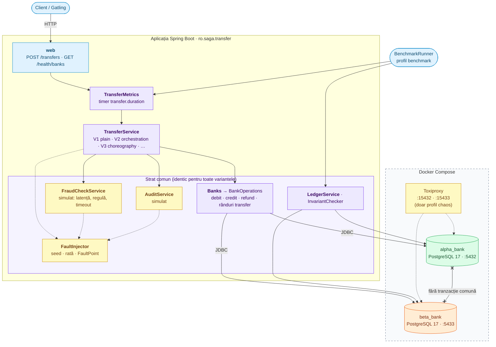
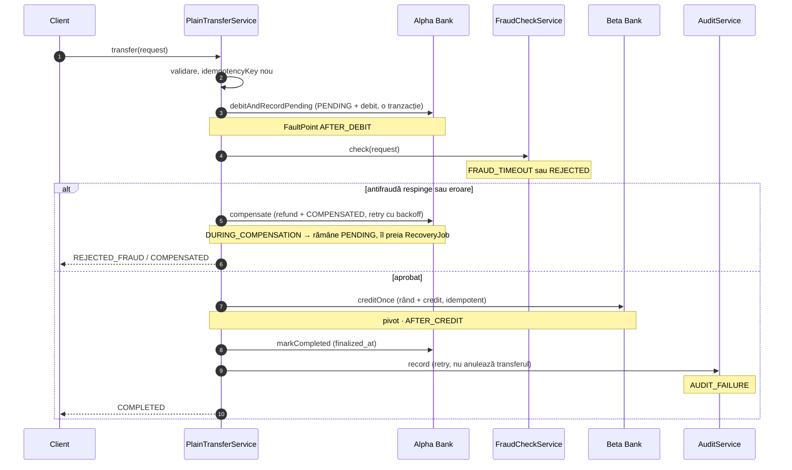
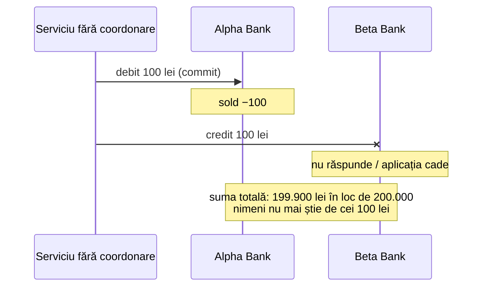

# Arhitectura

Aplicația este un singur serviciu Spring Boot care lucrează cu două baze de date PostgreSQL separate, câte una pentru fiecare bancă. Între cele două baze nu există nicio tranzacție comună.

Liniile punctate sunt locurile unde se injectează erori: `FaultInjector` în cod, Toxiproxy în rețea.

## Fluxul V1 (Plain-Correct)

Cei cinci pași din [contracts.md](contracts.md), cu locurile de eșec. Aceeași logică o refac V2, V3 și V5 cu pattern-uri.

## Problema fără coordonare

De ce e nevoie de compensare, idempotență și recuperare: fără ele, o bancă care nu răspunde după debit lasă banii „în aer”. Scenariul e demonstrat de `NoCoordinationDemoTest`, nu e o variantă de benchmark.

## Componente

| Componentă | Pachet | Rol |
|---|---|---|
| `BankHealthController` | `web` | Expune `GET /health/banks`: 200 dacă ambele bănci răspund, 503 altfel. |
| `BankHealthService` | `bank` | Verifică conexiunea la fiecare bancă. |
| `AlphaBankDataSourceConfig`, `BetaBankDataSourceConfig` | `config` | Câte un DataSource, Flyway, EntityManagerFactory și TransactionManager pentru fiecare bancă. |
| `BankPersistenceFactory` | `config` | Construiește componentele de persistență comune celor două bănci. |
| `AlphaBankAccount`, `AlphaBankAccountRepository` | `bank.alpha` | Entitatea și repository-ul pentru conturile Alpha Bank. |
| `BetaBankAccount`, `BetaBankAccountRepository` | `bank.beta` | Entitatea și repository-ul pentru conturile Beta Bank. |
| `Banks`, `BankOperations` | `bank` | Operațiile pe solduri și pe rândurile din `transfer`, comune tuturor variantelor. |
| `LedgerService`, `InvariantChecker` | `bank` | Suma totală, banii în zbor, fereastra de inconsistență, regulile I1–I3. |
| `SimulatedFaultInjector` | `fault` | Erori cu probabilitate `app.fault.rate` pe `FaultPoint`-urile din `app.fault.points`, reproductibile cu `app.fault.seed`. |
| `SimulatedFraudCheckService` | `fraud` | Respinge peste `app.fraud.max-amount` sau din `app.fraud.blocked-accounts`; latență `app.fraud.latency-ms`; timeout prin `FRAUD_TIMEOUT`. |
| `SimulatedAuditService` | `audit` | Pică la `AUDIT_FAILURE`, altfel numără înregistrările. |
| `TransferMetrics` | `observability` | Învelește orice `TransferService` cu timer-ul `transfer.duration` (etichete `variant`, `outcome`). |
| `PlainTransferService` | `plain` | Implementarea baseline V1 a `TransferService`: flux procedural în 5 pași, verificare antifraudă, credit idempotent, compensare cu backoff. |
| `RecoveryJob` | `plain` | Job `@Scheduled` pentru reconcilierea transferurilor `PENDING` vechi pe baza existenței creditului în destinație. |
| `TransferController` | `web` | Expune `POST /transfers` și `GET /transfers/{idempotencyKey}`, învelind execuția cu `TransferMetrics`. |

## Decizii

- **Două baze de date separate.** Simulează două bănci independente. Fiecare bancă are propriul server PostgreSQL în `docker-compose.yml`.
- **Persistență separată per bancă.** Fiecare bancă are propriul `EntityManagerFactory`, `TransactionManager` și propriile migrații Flyway (`db/migration/alpha_bank`, `db/migration/beta_bank`), rulate automat la pornire. Auto-configurarea Spring Boot pentru DataSource, JPA și Flyway este dezactivată, fiindcă funcționează doar cu o singură bază.
- **Schema gestionată de Flyway.** Hibernate doar validează că entitățile corespund schemei (`ddl-auto=validate`).
- **Fără `@Primary`.** Orice tranzacție trebuie să numească explicit banca pe care lucrează, de exemplu `@Transactional(AlphaBankDataSourceConfig.TRANSACTION_MANAGER)`.
- **Prepared transactions activate.** Ambele servere PostgreSQL pornesc cu `max_prepared_transactions=100`, necesar pentru `PREPARE TRANSACTION`.
- **Detectare rapidă a unei bănci căzute.** Timeout-ul de conexiune Hikari este de 3 secunde, configurabil per bancă în `application.yml`.
- **Pool configurabil.** `maximum-pool-size` (implicit 10) se setează per bancă și e factor experimental.
- **Erori reproductibile.** Fiecare thread are propriul `Random`, cu seed din `app.fault.seed` și numele thread-ului. Cu același seed și aceleași nume de thread-uri, erorile apar în aceleași locuri. Benchmark-ul poate schimba configurația între rulări cu `reconfigure(...)`.
- **Erori de rețea cu Toxiproxy.** `docker-compose.chaos.yml` pune un proxy în fața fiecărei bănci (`15432`, `15433`, API pe `8474`). Aplicația trece prin el doar cu profilul `chaos`.

## Ce urmează

Varianta V1 Plain-Correct este complet implementată în pachetul `plain` și acoperită de teste de integrare, concurență și anduranță. Urmează variantele cu design patterns pentru M2 și M3 (Saga cu orchestrare în `orchestration`, Saga cu coreografie în `choreography`, 2PC în `twophase` și Workflow Temporal). Pentru anti-pattern-ul shared database va fi adăugat un al treilea container PostgreSQL.
