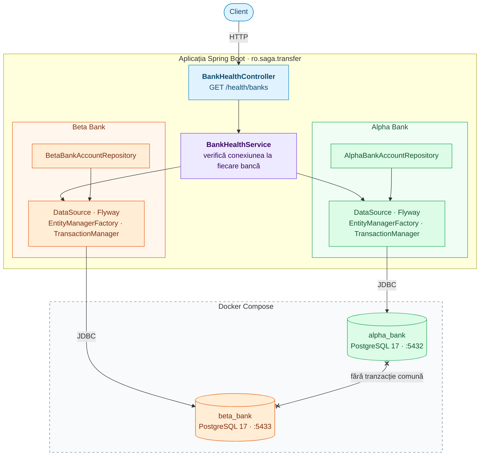

# Arhitectura

Aplicația este un singur serviciu Spring Boot care lucrează cu două baze de date PostgreSQL separate, câte una pentru fiecare bancă. Între cele două baze nu există nicio tranzacție comună.

## Componente

| Componentă | Pachet | Rol |
|---|---|---|
| `BankHealthController` | `web` | Expune `GET /health/banks`: 200 dacă ambele bănci răspund, 503 altfel. |
| `BankHealthService` | `bank` | Verifică conexiunea la fiecare bancă. |
| `AlphaBankDataSourceConfig`, `BetaBankDataSourceConfig` | `config` | Câte un DataSource, Flyway, EntityManagerFactory și TransactionManager pentru fiecare bancă. |
| `BankPersistenceFactory` | `config` | Construiește componentele de persistență comune celor două bănci. |
| `AlphaBankAccount`, `AlphaBankAccountRepository` | `bank.alpha` | Entitatea și repository-ul pentru conturile Alpha Bank. |
| `BetaBankAccount`, `BetaBankAccountRepository` | `bank.beta` | Entitatea și repository-ul pentru conturile Beta Bank. |

## Decizii

- **Două baze de date separate.** Simulează două bănci independente. Fiecare bancă are propriul server PostgreSQL în `docker-compose.yml`.
- **Persistență separată per bancă.** Fiecare bancă are propriul `EntityManagerFactory`, `TransactionManager` și propriile migrații Flyway (`db/migration/alpha_bank`, `db/migration/beta_bank`), rulate automat la pornire. Auto-configurarea Spring Boot pentru DataSource, JPA și Flyway este dezactivată, fiindcă funcționează doar cu o singură bază.
- **Schema gestionată de Flyway.** Hibernate doar validează că entitățile corespund schemei (`ddl-auto=validate`).
- **Fără `@Primary`.** Orice tranzacție trebuie să numească explicit banca pe care lucrează, de exemplu `@Transactional(AlphaBankDataSourceConfig.TRANSACTION_MANAGER)`.
- **Prepared transactions activate.** Ambele servere PostgreSQL pornesc cu `max_prepared_transactions=100`, necesar pentru `PREPARE TRANSACTION`.
- **Detectare rapidă a unei bănci căzute.** Timeout-ul de conexiune Hikari este de 3 secunde, configurabil per bancă în `application.yml`.

## Ce urmează

Variantele de transfer (naiv, 2PC, Saga cu orchestrare și Saga cu coreografie) vor fi adăugate în pachetele `naive`, `twophase`, `orchestration` și `choreography`, ca implementări ale unei interfețe comune. Pentru anti-pattern-ul shared database va fi adăugat un al treilea container PostgreSQL.
